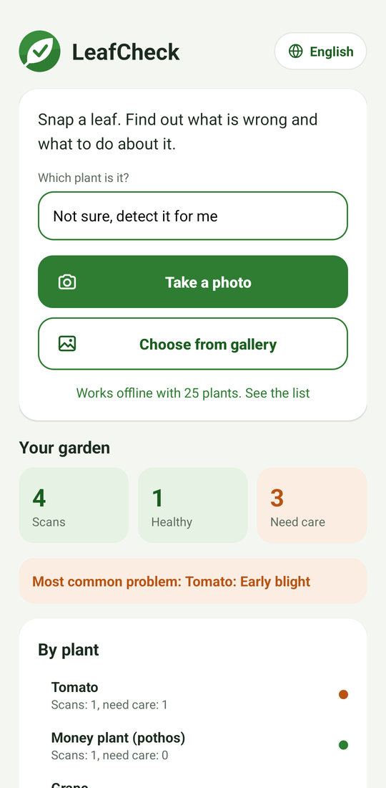
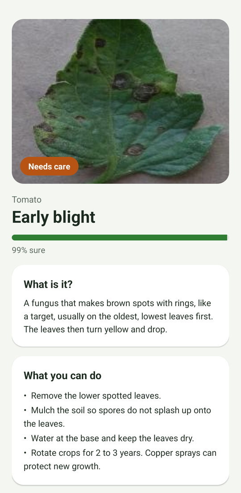
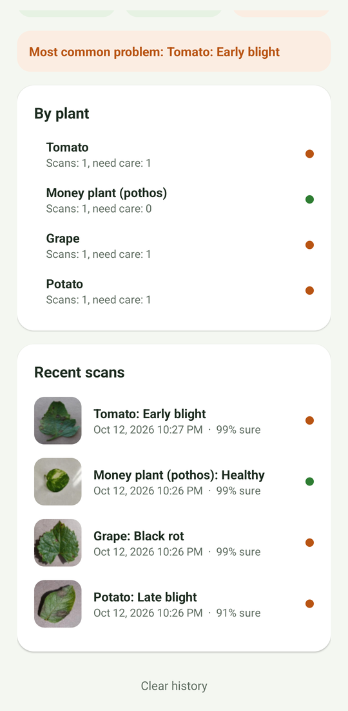
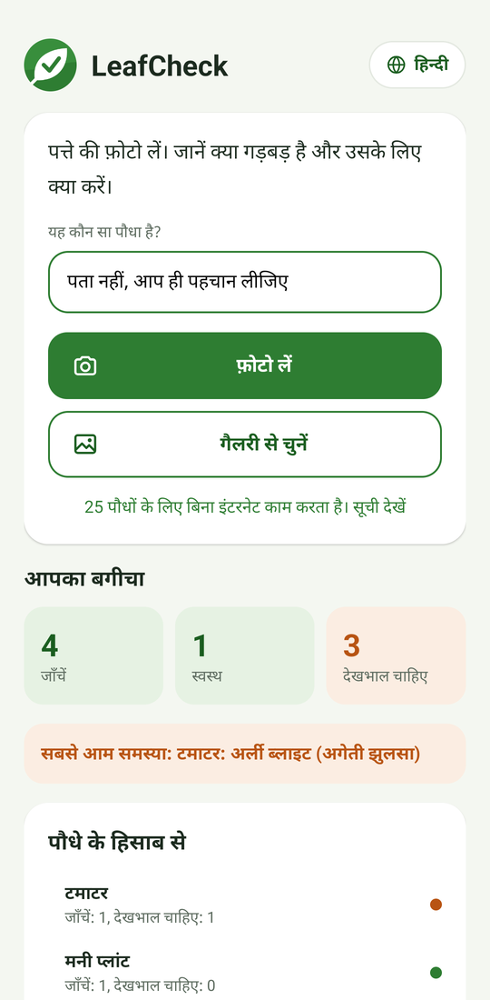
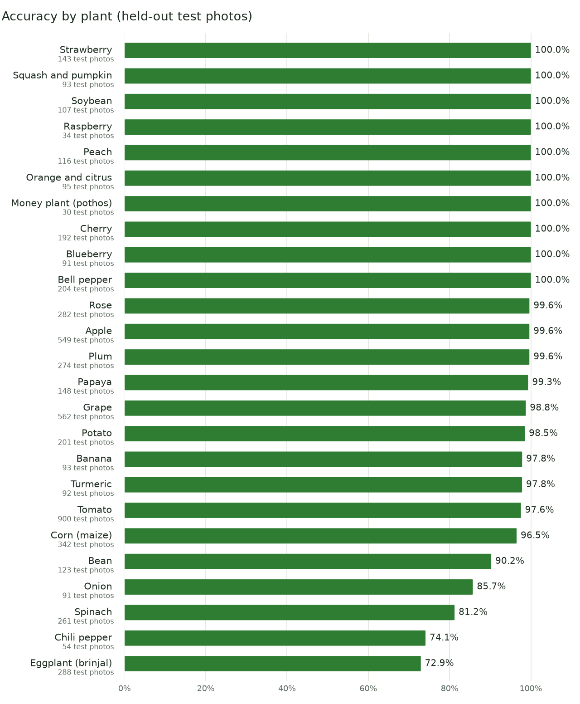

<p align="center">
  
</p>

<h1 align="center">LeafCheck</h1>

<p align="center">
  <b>Snap a photo of a sick leaf. Find out what is wrong and what to do about it.</b><br>
  Free, offline, private. In English, हिन्दी, Español, 中文 and العربية.
</p>

<p align="center">
  <a href="https://github.com/pranavragji/PlantDiseaseDetectionApp/releases/latest/download/LeafCheck.apk"><b>Download the APK</b></a>
  &nbsp;·&nbsp; Android 8.0 or newer &nbsp;·&nbsp; 19 MB &nbsp;·&nbsp; no account, no internet needed
</p>

<p align="center">
  
  
  
  
</p>

---

## Why this exists

Most of us have stood over a tomato plant or a money plant on the balcony, looking at a yellow, spotty leaf and wondering: is it the water, a bug, or something that will spread to everything else? Search engines give you fifty answers. A plant doctor is not on call.

LeafCheck is for that moment. You take one photo, and in about a second it tells you:

- **what it most likely is** (for example *Early blight* on tomato, or *Black spot* on a rose),
- **how sure it is**, and what else it could be,
- **what it actually means** in plain words, and
- **what you can do today**: simple steps like removing the right leaves, changing how you water, or which gentle spray helps.

It is built for home gardeners, balcony growers, kitchen gardens, school gardens and anyone who keeps a few plants alive, not for labs or big farms. Everything runs on the phone, so it works in the back garden with no signal, it costs nothing, and your photos never leave your device.

## What it does

| | |
|---|---|
| **Check a leaf** | Take a photo or pick one from the gallery. You can also share a photo into LeafCheck from your gallery app. |
| **Tell it the plant (optional)** | If you know it is a rose, pick "Rose" and LeafCheck only compares against rose problems. This makes it noticeably more accurate (see below). |
| **Plain-language advice** | Every result explains what the problem is and gives 3 to 4 practical care steps. Healthy leaves get general care tips. |
| **Honest about doubt** | If it is not sure, it says so, shows the other likely answers, and tells you how to take a better photo. |
| **Your garden dashboard** | Every check is saved on the phone: how many scans, how many healthy, how many need care, the most common problem, a per-plant summary and your recent scans with photos. Tap any scan to see it again. |
| **5 languages** | Tap the language button at the top to switch the whole app, including all plant and disease advice, between English, Hindi, Spanish, Chinese and Arabic (with a proper right-to-left layout). |
| **Works offline** | The model is inside the app. No internet, no sign-up, no ads, no tracking. |

## Plants it knows

**25 plants and 91 conditions** (plus a "this is not a leaf" check), up from the 14 lab crops of the original project. The new ones are the plants people actually grow at home: chili, eggplant (brinjal), onion, beans, spinach, papaya, banana, plum, rose, money plant (pothos) and turmeric.

| Plant | What LeafCheck can spot |
|---|---|
| Apple | scab, black rot, cedar apple rust, Alternaria leaf spot, mosaic virus, healthy |
| Banana | Cordana leaf spot, Pestalotiopsis, Sigatoka, healthy |
| Bean | angular leaf spot, rust, healthy |
| Bell pepper | bacterial spot, healthy |
| Blueberry | healthy |
| Cherry | powdery mildew, healthy |
| Chili pepper | Cercospora leaf spot, mites and thrips, nutrient deficiency, powdery mildew, healthy |
| Corn (maize) | gray leaf spot, rust, leaf blight, healthy |
| Eggplant (brinjal) | insect damage, leaf spot, mosaic virus, white mold, wilt, healthy |
| Grape | black rot, esca, leaf spot, bacterial spot, downy mildew, powdery mildew, healthy |
| Money plant (pothos) | bacterial wilt, too much manganese, healthy |
| Onion | iris yellow spot virus, leaf blight, purple blotch, healthy |
| Orange and citrus | citrus greening |
| Papaya | leaf curl, mealybugs, spider mites, mosaic virus, ringspot virus, healthy |
| Peach | bacterial spot, healthy |
| Plum | bacterial spot, shot hole, wilt, healthy |
| Potato | early blight, late blight, healthy |
| Raspberry | healthy |
| Rose | black spot, dry leaf, insect damage, healthy |
| Soybean | healthy |
| Spinach | anthracnose, bacterial spot, downy mildew, insect damage, healthy |
| Squash and pumpkin | powdery mildew |
| Strawberry | leaf scorch, healthy |
| Tomato | bacterial spot, early blight, late blight, leaf mold, Septoria leaf spot, spider mites, target spot, yellow leaf curl virus, mosaic virus, healthy |
| Turmeric | aphids, leaf blotch, leaf spot, healthy |

## How well it works

All numbers below were measured on the exact model file that ships inside the APK (3.4 MB), on photos it never saw during training.

| Test | Top answer right | Right answer in top 3 |
|---|---|---|
| Held-out test photos (5,448 photos, all 25 plants) | **95.9%** | 99.6% |
| Same, when you tell it which plant it is | **96.2%** | |
| Real-world photos from PlantDoc (1,016 photos taken in gardens and fields) | **57.7%** | 81.1% |
| Real-world photos, when you tell it which plant it is | **74.9%** | 96.0% |

<p align="center"></p>

**Reading these numbers honestly:**

- The held-out score is high because most training photos are clean: one leaf on a plain background. Your garden is messier, so expect the real-world line to be closer to what you will see.
- The first version of this model, trained only on those clean photos, got just 13.2% of real garden photos right (measured on all 2,569 PlantDoc photos, before any were used for training): it had learned "plain background vs busy background" instead of the leaf. Mixing in real garden photos from PlantDoc (and testing on a separate set of them it never saw) is what brought that up to 57.7%.
- Telling LeafCheck which plant it is makes the biggest difference, because it no longer has to guess the plant and the problem at the same time.
- Some plants have only a few hundred photos to learn from (see the chart), so treat their results as a strong hint, not a verdict.
- It only knows the conditions in the table above. If your plant has something else, it will pick the closest match. The "Other possibilities" list and the confidence bar are there for exactly that reason.

## What changed from the original

The 2020 version of this repo only ever had its Gradle files uploaded, so there was no working app. This is a full rebuild:

| | Before (2020) | Now (LeafCheck 2.0) |
|---|---|---|
| App | Gradle wrapper only, the app module was never pushed | Complete native Android app |
| Plants | none in the repo | 25 plants, 91 conditions |
| Model | none | MobileNetV3, trained and measured here, 3.4 MB, runs on the phone |
| Accuracy | not reported | 95.9% held-out, 57.7% on real-world photos, per-plant chart |
| Advice | none | Plain-language explanation and care steps for every condition |
| History | none | "Your garden" dashboard with stats and past scans |
| Languages | none | English, Hindi, Spanish, Chinese, Arabic (RTL) |
| Internet | | Not needed at all |
| Toolchain | AGP 3.5, Gradle 5.4, jcenter (shut down) | AGP 9, Gradle 9, Android 17 SDK, Kotlin |

## Install

1. On your Android phone, open the [latest release](https://github.com/pranavragji/PlantDiseaseDetectionApp/releases/latest) and download `LeafCheck.apk`.
2. Open the file. If Android asks, allow your browser to "install unknown apps".
3. Open LeafCheck, tap **Take a photo**, and point it at one leaf.

The APK is a release build signed with a development key, so if you later install a build signed differently you will need to uninstall the old one first.

### Getting a good result

- One leaf, filling most of the photo.
- Daylight, no harsh shadows or flash glare.
- Show the spots, holes or discoloured part clearly.
- If you know the plant, pick it from the list.

## How it works

```
photo -> square crop, 224 x 224 -> MobileNetV3 (TensorFlow Lite, on the phone) -> 92 scores
      -> keep only the picked plant's conditions (optional) -> top answer + care advice
```

- **Model:** MobileNetV3-Large pretrained on ImageNet, fine-tuned in two stages on about 45,700 different leaf photos (lab photos first, then mixed with real garden photos), exported to TensorFlow Lite with 8-bit weights. It runs with [LiteRT](https://ai.google.dev/edge/litert) on the phone's CPU.
- **App:** plain Kotlin and Android framework views, no ad or analytics SDKs. Scan history is a small JSON file in the app's private storage.
- **Languages:** every UI string and every disease explanation lives in `app/src/main/res/values-*/`. A unit test fails the build if any language is missing an entry for any condition the model can return.

### Build it yourself

You need JDK 21 and the Android SDK (platform 37).

```bash
./gradlew test assembleRelease
```

The APK lands in `app/build/outputs/apk/release/`.

### Retrain the model

```bash
pip install tensorflow pillow pyarrow huggingface_hub matplotlib
python ml/prepare_data.py ../plant-data
TF_ENABLE_ONEDNN_OPTS=0 python ml/train.py ../plant-data
python ml/charts.py
```

`prepare_data.py` downloads every dataset listed below from Hugging Face (about 3 GB), resizes the photos and splits them 80/10/10 (PlantDoc garden photos: 50% train, 10% validation, 40% real-world test). `train.py` trains on a CPU in a couple of hours, writes `model.tflite` and `labels.json` into the app, and saves all the scores to `ml/metrics.json`. Keep `TF_ENABLE_ONEDNN_OPTS=0`: with it on, fine-tuning crashed partway through on Windows. The script saves checkpoints in `../plant-data/ckpt`, so rerunning after a crash picks up where it stopped. To add a plant, add its dataset and label mapping to `SOURCES` in `prepare_data.py`, then add its names and advice to the `plants.xml` files.

## Data and credits

The model learned from these open datasets. Thank you to everyone who photographed and labelled them.

| Dataset | Plants | License |
|---|---|---|
| [PlantVillage](https://huggingface.co/datasets/mohanty/PlantVillage) (Hughes and Salathé, 2015) | 14 crops, 38 classes | CC BY-SA 3.0 |
| [COLD chili leaf](https://huggingface.co/datasets/Project-AgML/COLD_chili_leaf_disease_classification), [COLD onion leaf](https://huggingface.co/datasets/Project-AgML/COLD_onion_leaf_disease_classification) | chili, onion | CC BY 4.0 |
| [Eggplant disease](https://huggingface.co/datasets/Project-AgML/eggplant_disease_classification) | eggplant | CC BY 4.0 |
| [Money plant disease](https://huggingface.co/datasets/Project-AgML/money_plant_disease_classification) | money plant | CC BY 4.0 |
| [BananaLSD](https://huggingface.co/datasets/Project-AgML/BananaLSD_leaf_disease_classification) | banana | CC BY 4.0 |
| [iBean](https://huggingface.co/datasets/AI-Lab-Makerere/beans) (Makerere AI Lab) | bean | MIT |
| [Papaya leaf disease](https://huggingface.co/datasets/Project-AgML/papaya_leaf_disease_classification_bangladesh) | papaya | CC BY 4.0 |
| [Spinach leaf disease](https://huggingface.co/datasets/Project-AgML/IDDMSLD_spinach_leaf_disease_classification) | spinach | CC BY 4.0 |
| [Grape leaf disease](https://huggingface.co/datasets/Project-AgML/grape_leaf_disease_classification) | grape | CC BY 4.0 |
| [Plum leaf and fruit](https://huggingface.co/datasets/Project-AgML/plum_leaf_fruit_disease_classification) | plum (leaf photos only) | CC BY 4.0 |
| [Apple leaf disease](https://huggingface.co/datasets/Project-AgML/apple_leaf_disease_classification) | apple | CC BY 4.0 |
| [Turmeric leaf disease](https://huggingface.co/datasets/Project-AgML/turmeric_leaf_disease_classification) | turmeric | CC BY 4.0 |
| [Rose leaf set](https://huggingface.co/datasets/Project-AgML/roseleafset_disease_classification) | rose | CC BY 4.0 |
| [PlantDoc](https://huggingface.co/datasets/Project-AgML/plant_doc_classification) (Singh et al., 2020) | real garden photos: half used for training, 40% kept aside as the real-world test | CC BY-SA 4.0 |

The Project-AgML copies are mirrors maintained by the [AgML](https://github.com/Project-AgML/AgML) project; each dataset card there links to its original authors. Because PlantVillage is share-alike, the trained model file is shared under CC BY-SA as well.

## A friendly warning

LeafCheck is a helper, not a lab test. It can be wrong, especially on plants and problems it has not seen. For valuable plants, or if something is spreading fast, ask a local nursery or your agriculture extension office. Always follow the label on any spray, and keep sprays away from children and pets.
